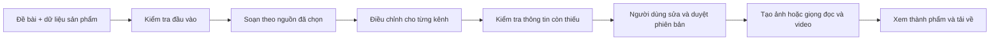

# Sổ Nội Dung — Thiết kế phiên bản đầu tiên

Ngày: 27/10/2026. Trạng thái: đề xuất để người dùng xem trước khi viết ứng dụng thật.

## 1. Mục tiêu và những gì đã thống nhất

Ứng dụng tiếng Việt, chỉ một người sử dụng, giúp tạo bài viết, ảnh và video để tiếp cận người làm kế toán và giới thiệu chữ ký số, phần mềm hóa đơn điện tử, giải pháp hỗ trợ BHXH. Hỗ trợ Facebook, TikTok, Zalo và YouTube. Người dùng duyệt nội dung rồi tải về để đăng.

Công nghệ người dùng chọn: **Next.js, Tailwind CSS, Lucide React, shadcn/ui, Firebase**. Dùng TypeScript xuyên suốt là lựa chọn của người triển khai.

Tham khảo giao diện: `.superpowers/brainstorm/853-1793096332/content/content-studio.html`. Giữ thanh điều hướng, xưởng nội dung, đề bài chiến dịch, bộ lọc bốn kênh và trình chỉnh sửa. Chuyển sang React component; không coi dữ liệu mẫu hoặc thanh tiến trình giả là chức năng đã hoàn thành. Tên “Sổ Nội Dung”, bảng màu xanh và bố cục hiện tại là phương án đề xuất, chưa phải thương hiệu được người dùng chốt.

## 2. Phạm vi và thứ tự bàn giao

| Mốc | Kết quả sử dụng được |
| --- | --- |
| A — Nội dung và ảnh | Đăng nhập, quản lý sản phẩm/nguồn, tạo và duyệt bài viết + kịch bản bốn kênh; tạo ảnh PNG; lưu và tải thành phẩm |
| B — Video | Tạo giọng đọc tiếng Việt, phụ đề và dựng MP4 từ kịch bản đã duyệt; phục hồi công việc khi đóng trình duyệt |

Hoàn thành A mới gọi là bản nội dung và ảnh; chỉ gọi hoàn thành toàn bộ phiên bản đầu tiên sau B. Hai mốc đều thuộc thiết kế này, B không bị bỏ khỏi phạm vi.

Chưa làm: tự đăng bài, lấy số liệu mạng xã hội, quản lý khách hàng, thanh toán/bán sản phẩm trực tiếp, tài khoản nhiều người, chatbot chăm sóc khách, video AI sinh toàn cảnh, avatar hoặc nhân bản giọng nói. Không cần kết nối tài khoản bốn mạng xã hội ở phiên bản này.

BHXH tạm hiểu là phần mềm/dịch vụ hỗ trợ kê khai, không phải bán quyền lợi bảo hiểm. Người dùng có thể đổi tên và mô tả trong danh mục.

## 3. Màn hình

| Màn hình / đường dẫn | Nội dung và hành động chính |
| --- | --- |
| Đăng nhập `/login` | Đăng nhập Google; chỉ UID chủ sở hữu được vào ứng dụng. Người khác nhận thông báo không có quyền, không được đọc dữ liệu hoặc gọi AI |
| Xưởng nội dung `/studio` | Chọn sản phẩm, chủ đề, mục tiêu, CTA, giọng văn, kênh và đầu ra; tạo chiến dịch; hiện rõ dữ liệu còn thiếu |
| Chiến dịch `/campaigns/[id]` | Theo dõi bước đang chạy, xem lỗi/thử lại; lọc theo kênh; chỉnh sửa, duyệt từng phiên bản; tạo ảnh/video sau duyệt; xem và tải kết quả |
| Chiến dịch đã lưu `/campaigns` | Tìm theo tên, lọc sản phẩm/trạng thái; mở và nhân bản chiến dịch; lưu trữ để ẩn khỏi danh sách mặc định |
| Sản phẩm `/products` | Thêm/sửa ba nhóm sản phẩm, nhà cung cấp, tính năng, giá tùy chọn, ưu đãi và tài liệu nguồn; đánh dấu thông tin đã xác nhận |
| Thiết lập `/settings` | Tên thương hiệu, logo, liên hệ/CTA mặc định; xem mô hình đang dùng, giới hạn tác vụ và mức sử dụng có ghi nhận. Không nhập khóa API vào Firestore |

Mỗi màn hình có trạng thái đang tải, trống, lỗi và thành công. Thao tác chính dùng bàn phím được. Kiểm tra ở chiều rộng 390, 768 và 1440 px, không tràn ngang. Nội dung đang sửa không bị bản cập nhật tiến trình ghi đè.

## 4. Dữ liệu Firebase

Firebase Authentication giữ danh tính. Tất cả dữ liệu ứng dụng đặt dưới `users/{ownerUid}`. Một UID cho toàn bộ ứng dụng; không xây hệ thống tổ chức hoặc phân vai.

| Đường dẫn tương đối | Trường chính |
| --- | --- |
| `profile/main` | `brandName`, `logoAssetId`, `contact`, `defaultCta`, `tone`, `timezone` mặc định `Asia/Ho_Chi_Minh` |
| `products/{id}` | `category`, `name`, `supplier`, `description`, `features[]`, `price` tùy chọn, `currency`, `offer`, `confirmedAt`, `sourceIds[]`, `revision`, `archivedAt` |
| `sources/{id}` | `title`, `type: text|url_note`, `text`, `url` tùy chọn, `checkedAt`, `effectiveFrom/To` tùy chọn, `confirmedByOwner`, `revision` |
| `campaigns/{id}` | `productId`, `productSnapshot`, `sourceSnapshots[]`, `topic`, `goal`, `cta`, `tone`, `channels[]`, `requestedOutputs[]`, `status`, `revision`, `archivedAt`, timestamps |
| `campaigns/{id}/contents/{contentId}` | `channel`, `kind: post|script`, `currentVersion`, `reviewStatus`, `approvedVersion`, `approvedAt` |
| `.../contents/{contentId}/versions/{versionId}` | `body`, `hook`, `caption`, `scenes[]` nếu video, `sourceRefs[]`, `needsVerification[]`, `origin: ai|manual|demo`, `model`, `promptVersion`, `createdAt` |
| `campaigns/{id}/assets/{assetId}` | `kind: image|audio|video|captions`, `storagePath`, `mimeType`, `width/height/duration`, `contentId`, `contentVersion`, `status`, `generationJobId` |
| `campaigns/{id}/jobs/{jobId}` | `type`, `stage`, `status`, `inputSnapshot/hash`, `idempotencyKey`, `attempt`, `leaseExpiresAt`, `providerRequestId`, `outputIds`, `errorCode`, timestamps |
| `usage/{eventId}` | `jobId`, `provider`, `model`, lượng sử dụng thực tế nếu có, chi phí ước tính/thực tế tách riêng, `currency`, `pricingVersion` nếu ước tính |

Tệp nằm ở Cloud Storage: `users/{uid}/campaigns/{campaignId}/{assetId}.{ext}`; logo tại `users/{uid}/brand/`. Firestore chỉ giữ metadata. Các snapshot và văn bản đầu vào có giới hạn kích thước; không nhúng ảnh/video/base64 vào document.

Giá bán không bắt buộc; thiếu giá thì bỏ giá khỏi nội dung. Thiếu nhà cung cấp, tính năng, ưu đãi hoặc thông tin liên hệ thì hiển thị phần cần bổ sung, không tự bịa. Mốc A nhận nguồn bằng văn bản dán và URL kèm ghi chú do người dùng nhập; không tự đọc nội dung URL, không nhập PDF/Word và không tìm kiếm web tự động.

## 5. Luồng AI và duyệt

Một agent điều phối, các công cụ chuyên biệt; không dựng tám agent chạy độc lập. Dùng **eve + AI SDK** là đề xuất kỹ thuật của người triển khai, không thay đổi bộ công nghệ người dùng đã chọn. Mỗi bước có đầu vào snapshot, đầu ra có schema và giới hạn số lần gọi mô hình. Không trao quyền đăng mạng xã hội hoặc tự sửa bảng giá cho agent.

1. Chọn sản phẩm và nguồn; kiểm tra đầu vào ở máy chủ, tạo chiến dịch và công việc bền vững rồi trả `202 + jobId`.
2. Agent đọc đúng snapshot. Không gọi “nghiên cứu thị trường” nếu chỉ đang đọc tài liệu do người dùng cung cấp.
3. Soạn chủ đề, bài viết hoặc kịch bản; chuyển thành đầu ra theo các kênh đã chọn. Chỉ lưu kết quả sau khi qua schema validation.
4. Gắn `sourceRefs` và `needsVerification`. Dẫn nguồn chỉ là tham chiếu dữ liệu đã cung cấp, không phải xác nhận pháp lý tự động. Thông tin thuế/quy định phải có nguồn phù hợp và ngày kiểm tra; nếu thiếu thì bỏ khẳng định hoặc chặn duyệt cho tới khi người dùng bổ sung/xác nhận.
5. Người dùng sửa và duyệt từng phiên bản. Nội dung sửa hoặc tạo lại có phiên bản mới và mất trạng thái duyệt; không làm mất phiên bản cũ.
6. Chỉ nút tạo ảnh/video sau duyệt mới phát sinh công việc media. Công việc dùng phiên bản đã duyệt tại thời điểm bấm; sửa tiếp không làm thay đổi một render đang chạy. Thành phẩm từ bản cũ được ghi rõ “phiên bản cũ”.
7. Xem trước, tải bài viết TXT, ảnh PNG, kịch bản TXT, phụ đề SRT và video MP4. Không có tệp thì không hiện nút tải giả.

## 6. Đầu ra theo kênh

| Kênh | Đầu ra mốc A | Đầu ra mốc B |
| --- | --- | --- |
| Facebook | Bài viết + ảnh 1080×1080 + kịch bản video ngắn | MP4 dọc 1080×1920 và caption |
| TikTok | Hook + kịch bản cảnh + caption | MP4 dọc 1080×1920, giọng đọc, phụ đề |
| Zalo | Bài giới thiệu ngắn + ảnh 1080×1080 | MP4 dọc để tải về, người dùng tự chọn hình thức đăng |
| YouTube | Tiêu đề, mô tả, kịch bản Shorts | MP4 Shorts dọc 1080×1920 |

Đây là preset xuất của ứng dụng, không phải cam kết về mọi giới hạn đăng của nền tảng. Bản đầu chưa làm video YouTube dài. Một chiến dịch tối đa bốn kênh, một bài/kịch bản và một ảnh hoặc một video cho mỗi kênh được chọn. Video mục tiêu 30–60 giây, tối đa sáu cảnh; đây là giới hạn sản phẩm đề xuất để kiểm soát phạm vi.

Ảnh: AI tạo nền/minh họa; ứng dụng chèn chữ tiếng Việt, logo và liên hệ bằng template cố định. Cho phép dùng nền hình học không gọi AI khi người dùng chọn. Lưu PNG thực, không nghiệm thu SVG mẫu thay cho ảnh hoàn chỉnh.

Video: dùng Remotion ghép ảnh, voiceover từ dịch vụ TTS tiếng Việt và phụ đề theo thời gian audio. Không gọi “video đã tạo” khi mới có kịch bản. Chọn một giọng tổng hợp có sẵn, không nhân bản giọng nói. Dùng nhạc do người dùng cung cấp quyền sử dụng hoặc không nhạc.

## 7. Kiến trúc và công việc chạy nền

- **Web:** Next.js App Router + TypeScript; Tailwind CSS, shadcn/ui, Lucide React. Firebase App Hosting là đích triển khai đề xuất.
- **Danh tính/dữ liệu:** Firebase Auth, Firestore, Storage; Firebase Admin chỉ chạy phía máy chủ. Browser đọc tiến trình qua Firestore, mọi thay đổi nghiệp vụ đi qua API được xác thực.
- **Công việc nền:** Cloud Tasks gọi worker Node trên Cloud Run qua IAM. Worker thực hiện từng bước giới hạn thời gian, ghi checkpoint vào Firestore. Remotion dùng worker render riêng khi tới mốc B.
- **Agent:** eve dùng phiên thực thi giới hạn trong một bước. Trạng thái chiến dịch, chờ duyệt và phục hồi giữa các lần chạy do Firestore + hàng đợi nắm giữ. Không dựa vào filesystem tạm hoặc phiên eve cũ trên Cloud Run để bảo đảm lưu trữ. Kiểm chứng cách gọi eve server-to-server và hoàn tất một bước trong worker trước khi nối tính năng thật; không tự thay runtime nếu kiểm chứng thất bại.
- **Mô hình:** cấu hình server cho `text`, `image`, `tts`; chọn provider/model sau một thử nghiệm tiếng Việt nhỏ và ghi quyết định. Không khóa model ID hoặc giá API chưa kiểm tra vào tài liệu. Có adapter mock để phát triển, nhãn demo rõ ràng; nghiệm thu tính năng AI phải dùng provider thật.

Trạng thái campaign: `draft → generating → review → ready`; `ready` nghĩa các đầu ra đã yêu cầu đều có thành phẩm hiện hành đã duyệt. Job: `queued → running → succeeded | failed | needs_reconciliation | cancelled`. `review` có thể tồn tại khi một phần nội dung khác đang tạo media; tiến trình chi tiết thuộc job. Luôn có lỗi theo kênh, không đánh dấu cả chiến dịch thành công nếu một đầu ra thất bại.

Chống chạy trùng bằng khóa yêu cầu, transaction nhận việc và lease; lưu provider request ID ngay khi có. Retry không tạo lại đầu ra đã lưu. Nếu timeout xảy ra sau khi provider có thể đã thu phí mà không tra cứu được kết quả, chuyển `needs_reconciliation`, không tự gọi lại tác vụ trả phí. Không hứa “chỉ tính phí đúng một lần” khi provider không hỗ trợ bảo đảm đó.

Tạo job và bản ghi cần gửi hàng đợi trong cùng transaction; dispatcher gửi lại bản ghi còn treo bằng tên task ổn định. Job chưa được enqueue không được hiển thị là đang chạy. Có thao tác thử lại bước thất bại và hủy các bước chưa bắt đầu; hủy không cam kết hoàn phí công việc provider đã nhận.

## 8. Truy cập, vận hành và giới hạn chi phí

- Cấu hình `OWNER_UID` ở server; mọi API kiểm tra Firebase ID token và UID. Firestore/Storage Rules chặn người lạ, chỉ cho owner đọc dữ liệu của mình; client không được ghi trạng thái duyệt, job, usage hoặc nội dung trực tiếp. Worker được cấp quyền riêng; Admin SDK bỏ qua Rules nên API vẫn phải kiểm tra quyền.
- Browser gửi ID token qua Authorization; server xác minh token cho từng yêu cầu. Không dùng cookie session trong bản đầu. Có kiểm tra Origin cho API thay đổi dữ liệu; không đặt token vào URL. Logout xóa phiên client.
- Khóa AI để trong Secret Manager/môi trường server. `NEXT_PUBLIC_*` chỉ dành cho cấu hình client công khai. Không có service-account JSON hoặc khóa provider trong Git, log, Firestore hay gói tải về.
- Tệp tải lên đầu tiên chỉ gồm logo PNG/JPEG/WebP, tối đa 5 MB; kiểm tra MIME thực, kích thước và quyền. Không nhận SVG tùy ý. Các nguồn dạng văn bản có giới hạn độ dài.
- Không render model HTML hoặc thực thi mã do AI sinh. Không để worker tải URL bất kỳ do model cung cấp; chỉ dùng Storage nội bộ và endpoint provider cấu hình sẵn.
- Giới hạn ban đầu: một công việc video chạy cùng lúc; số lần gọi, retry và kích thước đầu ra có trần. Trước tác vụ trả phí hiển thị đầu ra/số lượng và ước tính nếu có dữ liệu giá; không thể ước tính thì ghi rõ. Hạn mức tiền chưa được chọn: chưa bật AI trả phí production cho đến khi cấu hình hạn mức ứng dụng. Cảnh báo ngân sách Google Cloud không được coi là công tắc chặn chi phí cứng.
- Production dùng dự án Firebase riêng với billing cần thiết; emulator và provider mock dùng cho phát triển. Thời gian lưu UTC, hiển thị giờ Việt Nam. Không ghi token hoặc toàn bộ tài liệu người dùng vào log vận hành.

## 9. Tiêu chí hoàn thành

| ID | Bằng chứng nghiệm thu |
| --- | --- |
| AC01 | Owner đăng nhập được; người chưa đăng nhập hoặc UID khác không đọc/ghi dữ liệu, không tải tệp và không gọi AI được |
| AC02 | Thêm/sửa sản phẩm và nguồn; mở lại trên trình duyệt khác vẫn thấy dữ liệu; không chỉ lưu localStorage |
| AC03 | Chạy một chủ đề cho cả bốn kênh với provider thật, có nội dung riêng từng kênh; lưu model, nguồn và phiên bản |
| AC04 | Thiếu giá/ưu đãi không sinh giá/ưu đãi giả; thiếu nguồn quy định được đánh dấu và xử lý trước khi duyệt |
| AC05 | Sửa nội dung đã duyệt tạo phiên bản mới và yêu cầu duyệt lại; render bám đúng snapshot, không ghi đè bản mới |
| AC06 | Tạo và tải PNG thật có dấu tiếng Việt/logo đúng; file lỗi không được ghi thành công |
| AC07 | Mốc B tạo MP4 xem được, đúng chiều dọc, audio nghe được, phụ đề đọc được; có TXT/SRT tương ứng |
| AC08 | Đóng trang trong lúc chạy rồi mở lại vẫn theo dõi được công việc; retry bước lỗi không làm mất phần đã xong |
| AC09 | Bấm chạy hai lần với cùng khóa không tạo hai job; timeout mơ hồ không tự nhân đôi yêu cầu trả phí |
| AC10 | Xem được usage có ghi nhận, phân biệt ước tính/thực tế; từ chối tác vụ vượt hạn mức ứng dụng đã cấu hình |
| AC11 | Luồng tạo → sửa → duyệt → tạo media → tải được kiểm tra trên desktop/mobile; không có nút chính không hoạt động |
| AC12 | Có bản chạy riêng tư theo kiểm soát truy cập ứng dụng, README cấu hình, bản sao dữ liệu thử và hướng dẫn vận hành; không tự đăng lên mạng xã hội |

## 10. Đầu vào và quyết định còn lại

Người dùng cần cung cấp khi cấu hình thật: tài khoản/dự án Firebase, UID được phép, thông tin sản phẩm/nhà cung cấp, giá nếu muốn công bố, logo/liên hệ, tài liệu nguồn và hạn mức sử dụng. Đây không phải điều kiện để hoàn thành tài liệu hoặc xây giao diện/emulator. Không gửi mật khẩu hoặc khóa bí mật trong chat.

Người triển khai được quyết định: tên component, thư viện form/schema, template ảnh/video, preset giọng văn, cấu trúc code và model cụ thể sau benchmark. Mọi lựa chọn đó phải được ghi lại; không coi là yêu cầu người dùng đã chốt. Chưa kích hoạt billing, tạo tài nguyên cloud, gọi AI có phí, kết nối mạng xã hội hoặc triển khai trong giai đoạn viết tài liệu này.

## 11. Tài liệu kỹ thuật đã đối chiếu

- [Next.js App Router](https://nextjs.org/docs/app), [shadcn/ui với Next.js](https://ui.shadcn.com/docs/installation/next), [Lucide React](https://lucide.dev/guide/react).
- [Firebase App Hosting](https://firebase.google.com/docs/app-hosting): hỗ trợ Next.js và yêu cầu Blaze khi triển khai theo hướng này.
- [Cloud Tasks với Firebase](https://firebase.google.com/docs/functions/task-functions): tác vụ nền, retry và giới hạn tốc độ; thiết kế idempotency của ứng dụng vẫn cần tự làm.
- [eve deployment](https://eve.dev/docs/guides/deployment/overview), [execution model](https://eve.dev/docs/concepts/execution-model-and-durability): self-host có yêu cầu workflow storage riêng; filesystem tạm không được coi là lưu trữ bền vững.
- [AI SDK](https://ai-sdk.dev/docs/introduction), [Remotion](https://www.remotion.dev/docs/): adapter mô hình và dựng video theo template.

Khi triển khai, đọc lại tài liệu đúng phiên bản đã cài; các đường dẫn API/package có thể thay đổi. Thiết kế này không yêu cầu chọn phiên bản thư viện mới nhất bằng suy đoán.
